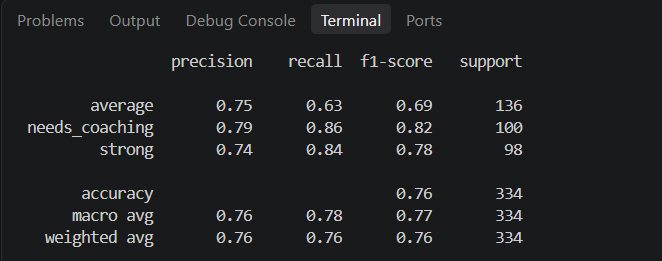
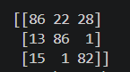
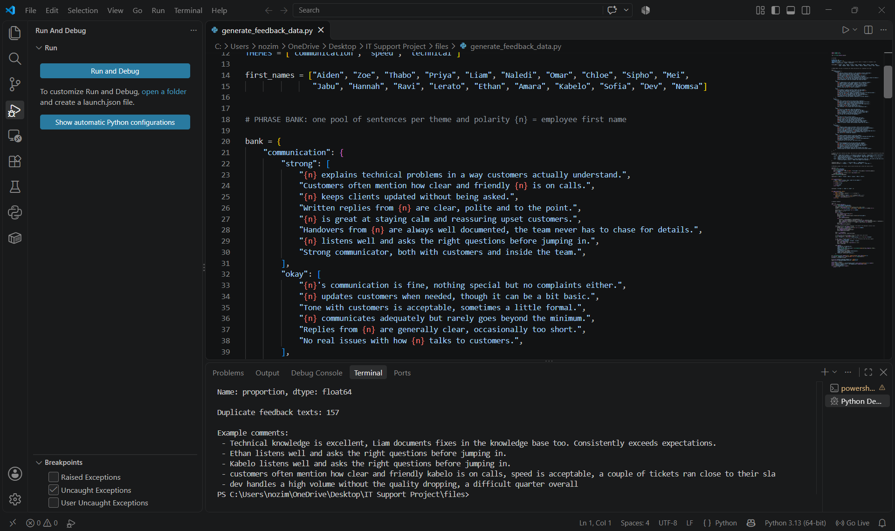

# Model 2: Employee Performance Evaluation Model

## Overview

This model was trained on synthetic data. It evaluates an employee's performance based on the comments they received from their senior/supervisor, who analyses the way they responded to a ticket, using NLP techniques. It then recommends a mentor/colleague who can help them improve their performance.

The whole project was supposed to be one integrated model: analyse resolved tickets and predict whether the target SLA was reached or not, find out who resolved the tickets and how well they solved them. It ended up being two models. Since the dataset I used to train the first model was not aligned with the second model, I decided to use synthetic data to train this one.

> **Please note:** for this second model I do not have much knowledge of Natural Language Processing (NLP) techniques, so this model is mostly AI-assisted.

## Where I got the dataset

The dataset used to train the model was generated by AI, since I couldn't find a dataset that fits this model on Kaggle or Hugging Face. The features and the target were defined by the AI on its own, since I'm still learning Natural Language Processing (NLP).

## Python Libraries Used

- NumPy
- Pandas
- Scikit-Learn

## Challenges of the Model

- During the testing of the model, I realised that when I input my own comment for it to evaluate, the model makes incorrect evaluations. When I checked the problem, I found that the reason it does this is that it gave itself a template of statements, like how a sentence must be structured when it is said to be good, middle or bad.

## Performance Metrics of the Model (Findings)

<!-- Add the performance metrics screenshots and your findings here -->

NB: The model was tested on 334 comments that it had not seen during training.

The model classifies each supervisor comment into one of three performance levels: **strong**, **average** or **needs coaching**. It reached an overall **accuracy of 76%**, which means that roughly 3 out of every 4 comments were classified correctly. This is well above guessing: a model that always picked the most common level would only score about 30%.

### What the results mean for each level

- **Needs coaching (precision 0.79, recall 0.86, f1-score 0.82):** This is the model's best result, and it is also the most important one for this project. The model found 86% of the comments that really belong to employees who need coaching. When it said an employee needs coaching, it was right 79% of the time, so about 1 in 5 of those flags is a false alarm.
- **Strong (precision 0.74, recall 0.84, f1-score 0.78):** The model is good at spotting top performers, finding 84% of them, which matters because they are the ones recommended as mentors. It sometimes labels a comment as strong when it is really average.
- **Average (precision 0.75, recall 0.63, f1-score 0.69):** This is the weakest level. The model missed 37% of the average comments. This makes sense because "average" sits between the other two levels. A comment can sound a bit positive and a bit negative at the same time, so it is easily mistaken for strong or needs coaching.

### Overall scores

- **Macro average (f1-score 0.77):** This treats all three levels equally. It is close to the overall accuracy, which shows that the model is not only good at one level while failing the others.
- **Weighted average (f1-score 0.76):** This takes into account how many comments each level has. It matches the accuracy, which shows the result is not being pushed up by one large group.
- **Support:** The three levels have a similar number of comments (136, 100 and 98), so the data is fairly balanced and the scores are fair to compare.

### What this tells me about the model

The model works well at its main job, which is finding employees who need coaching and the top performers who can mentor them. It is less reliable at telling the middle group apart, so its output should support a supervisor's judgement and not replace it.

These scores need to be read with care. The data is synthetic and written from a fixed phrase bank, so the model is good at recognising that wording. Real supervisor feedback is messier, so I would expect lower scores on real comments. This links to the limitation described below.

In the above screenshots, the numbers on the diagonal (86, 86 and 82) are the correct predictions. In total the model got **254 of the 334 comments right and 80 wrong**, which gives the 76% accuracy.

**What the matrix shows**

- **The model almost never confuses the two extremes.** Only 1 needs-coaching comment was labelled strong, and only 1 strong comment was labelled needs coaching. This matters for the project, because it means the model is very unlikely to recommend a struggling employee as a mentor, or to tell a top performer that they need coaching.
- **Most mistakes involve the average level.** Of the 80 wrong predictions, 50 were average comments labelled as either strong (28) or needs coaching (22). That is 62% of all errors, which fits the lower recall for average (0.63) in the metrics. Comments in the middle are the hardest to place, because they can sound a bit positive and a bit negative at once.
- **Mistakes lean towards the middle.** When the model got a strong or needs-coaching comment wrong, it mostly chose average (15 and 13 times). That is a milder error than jumping to the opposite level.
- **Most false alarms for needs coaching are really average.** The model flagged 109 comments as needs coaching, and 86 were correct. Of the 23 wrong ones, 22 were average comments, so a supervisor reviewing the flags would mostly find borderline cases and not strong performers.

Overall, the model is reliable at separating strong performers from those who need coaching, and less certain about the middle group.
## Limitations of the Model

I thought that the model analyses the sentence construction token by token to evaluate and give the performance of the employee. Instead, I found out that the model has a specific comment template that it gave itself, and it uses it to evaluate the performance and speed of the specific employee.

That may affect the model's evaluation, because a statement can be tweaked using synonyms, and the model may have difficulty evaluating comments that are outside the phrase bank.

## How the Model is Relevant to Solving the Real Problem at Hand

This model stretches the idea of improving employee performance. It would help the IT Support department to analyse the performance of each and every employee and see which ones are best performing, which are in the middle class, and which need coaching. It then recommends mentors, such as top performers who excel at the very same skills the others are struggling with.

This would help improve the performance of the overall IT company.
